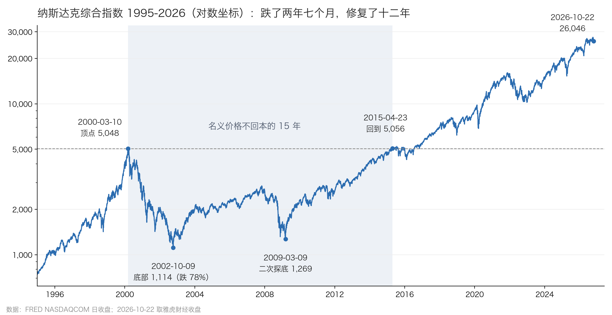
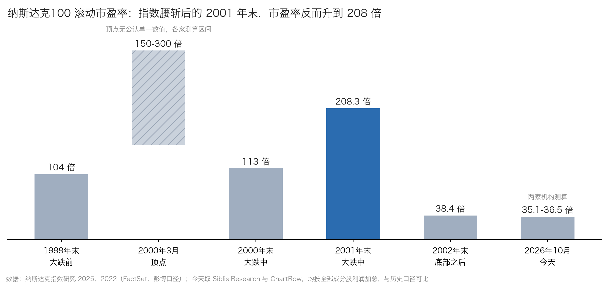

# 纳指崩盘 78%：苹果从底部涨了 1000 倍

2002 年 10 月 9 日，苹果公司的市值是 49 亿美元。它账上的现金和短期投资有 43 亿美元，债务 3 亿美元。扣掉这些，市场给苹果的电脑、软件和刚上市一年的 iPod，一共估价不到 10 亿美元。

同一天，纳斯达克综合指数收于 1,114 点。两年七个月前，它在 5,048 点，中间跌掉 78%。

2026 年 10 月 22 日，苹果市值 5.05 万亿美元，是那一天的 1,030 倍。纳指收于 26,046 点。

关于那段历史，流传最广的说法是“纳指十年阴跌”。把当年的行情和财报原件重新翻一遍，这句话一半对，一半错：十五年不回本是真的；阴跌是错的。

## 一、跌了两年七个月，从底部修了十二年半

纳指 2000 年 3 月 10 日收于 5,048.62 点，这是泡沫的顶点。此前五年，它从 1995 年底的 1,052 点涨到了这里，其中 1999 年一年涨了 86%。

之后的路径分四段：

| 阶段 | 时间 | 纳斯达克综合指数 |
| --- | --- | --- |
| 第一次暴跌 | 2000-03 至 2002-10，两年七个月 | 5,048 → 1,114，跌 78% |
| 反弹 | 2002-10 至 2007-10，五年 | 回到 2,859，仍比顶点低 43% |
| 第二次暴跌 | 2007-10 至 2009-03，一年四个月 | 2,859 → 1,269，跌 56% |
| 二次修复 | 2009-03 至 2015-04，六年 | 2015 年 4 月 23 日收于 5,056，名义价格回本，距 2002 年底部十二年半 |

从顶点到回本，用了 15 年 1 个月。如果扣掉通胀，要到 2018 年 1 月，接近 18 年。科技股权重更高的纳斯达克100 跌得更深，最大跌幅 83%，名义回本到 2015 年 11 月。

2000 年到 2015 年这 16 个自然年里，纳指下跌的年份只有 5 个：2000、2001、2002、2008、2011。其余 11 年都在涨。亏损集中在 2000-2002 年和 2008 年两段陡坡里，而 2008 年那一跌的起因是房地产和银行，与科技股估值无关。

“十五年”说的是在最高点一次性买入、只看价格的人。换一种买法，结果差很多：

- **算上分红再投资**：跟踪纳斯达克100 的基金 QQQ，从 2000 年 3 月的高点买入，只看价格要到 2016 年 9 月才回本（基金每年有管理费），算上分红再投资是 2015 年 2 月。
- **从顶点开始每月定投**：每月第一个交易日买入同样金额，投纳斯达克综合指数，2003 年 11 月账面回正；投纳斯达克100，2004 年 11 月回正。投到 2010 年 3 月，两者分别浮盈 18% 和 25%。

所以那十五年是两次暴跌，加上一段被 2008 年打断的修复。“阴跌”这个词，把最危险的部分说轻了。真实的风险是两年多跌去近八成：没加杠杆的人可以等，加了杠杆的人等不到修复那一天。

## 二、估值：腰斩之后，市盈率反而更高

下图是纳斯达克100 的滚动市盈率，也就是指数市值除以成分股最近四个季度的利润。

2000 年 3 月的顶点没有一个公认的数，各家测算在 150 到 300 倍之间。1999 年末是 104 倍。

到 2001 年末，纳斯达克100 比 1999 年末跌了 57%，滚动市盈率却从 104 倍升到 208 倍。两个数一倒推，成分股的利润跌了约八成。客户停止采购，科技公司的利润在 2001 年大面积塌方，跌得比股价还快。市盈率真正降下来，是 2002 年利润企稳之后的事，2002 年末为 38 倍。

“跌了很多所以便宜了”，在 2001 年是一个陷阱。

再看公司层面。把今天仍然存在的 8 家科技巨头单独拿出来：微软、苹果、英伟达、亚马逊、思科、英特尔、甲骨文、高通。8 家当成一家公司来算，用总市值去除总利润、总收入、总净资产：

| 时点 | 合计市值 | 市盈率 | 市销率 | 市净率 |
| --- | --- | --- | --- | --- |
| 2000-03-10 顶点 | 1.77 万亿美元 | 89 倍 | 20 倍 | 19 倍 |
| 2002-10-09 底部 | 0.47 万亿美元 | 34 倍 | 4.8 倍 | 3.6 倍 |
| 2026-10-22 今天 | 18.18 万亿美元 | 29 倍 | 8.6 倍 | 11.6 倍 |

市销率是市值除以一年收入，市净率是市值除以净资产。利润、收入都取每个估值日之前已公布财报的最近四个季度，也就是投资者当天能看到的数。

8 家里单家最贵的是高通，市盈率 293 倍；思科 231 倍，甲骨文 160 倍。不在这 8 家里的雅虎，市盈率 1,534 倍、市销率 159 倍。这 8 家都是活到今天的公司，朗讯、雅虎这类没活下来的不在样本里，所以这组数字还低估了当年的整体泡沫程度。

## 三、十五年回本的算术：市盈率降到五分之一，利润就要涨到五倍

股价等于每股利润乘以市盈率。市盈率降到原来的几分之一，利润就得涨几倍，股价才能回到原位。

假设市盈率从 100 倍回到 20 倍，降到五分之一，利润就必须涨到 5 倍。利润每年增长 11%，涨到 5 倍需要 15 年：1.11 的 15 次方约等于 4.8。这里的 100 倍和 20 倍只是示意，与上面纳斯达克100 从 104 倍到 38 倍、再到后来的二十几倍是同一个过程。

一次估值回归，加上每年 11% 的利润增长，就能算出 15 年左右的回本时间，用不着阴跌。2008 年那一跌，又把修复往后推了几年。

## 四、十一家公司：顶点、底部、今天的市值

| 公司 | 2000-03-10 顶点 | 2002-10-09 底部 | 2026-10-22 今天或结局 | 今天 ÷ 顶点 | 今天 ÷ 底部 |
| --- | --- | --- | --- | --- | --- |
| 英伟达 | 36 | 11.3 | 51,234 | 1,423 倍 | 4,534 倍 |
| 苹果 | 203 | 49 | 50,457 | 249 倍 | 1,030 倍 |
| 微软 | 5,257 | 2,366 | 38,947 | 7.4 倍 | 16 倍 |
| 亚马逊 | 228 | 64 | 27,143 | 119 倍 | 424 倍 |
| 英特尔 | 4,016 | 897 | 4,340 | 1.1 倍 | 5 倍 |
| 思科 | 4,666 | 672 | 4,122 | 0.9 倍 | 6 倍 |
| 甲骨文 | 2,303 | 432 | 3,747 | 1.6 倍 | 9 倍 |
| 高通 | 964 | 217 | 1,815 | 1.9 倍 | 8 倍 |
| 朗讯 | 2,168 | 23 | 2006 年作价 134 亿与阿尔卡特合并 | — | — |
| 太阳微系统 | 1,487 | 83 | 2010 年被甲骨文以 74 亿收购 | — | — |
| 雅虎 | 937 | 60 | 2017 年核心业务作价 44.8 亿出售 | — | — |

单位：亿美元。市值为当天收盘价乘以当时最新财报封面的流通股数。

这张表有两个反差：

- **底部时挤在一起，后来相差上千倍**：2002 年 10 月，苹果 49 亿、雅虎 60 亿、亚马逊 64 亿、太阳微系统 83 亿，几乎挤在同一个位置。二十四年后，前两家和后两家之间相差一千倍以上。
- **顶点时最大的三家，今天回报最低**：2000 年 3 月市值最大的三家是思科、微软、英特尔，今天相对顶点分别是 0.9 倍、7.4 倍、1.1 倍。

标题里的 1,000 倍说的是市值。苹果按拆股调整后的股价，从那天到今天涨了约 1,400 倍，比市值涨得更多，因为这些年苹果的总股数减少了约 27%，主要来自回购。以上都不含分红。

## 五、苹果、亚马逊、英伟达：底部时一点都不像赢家

**苹果**。 2000 年 3 月，它是一家个人电脑公司，市盈率 32 倍、市销率 3 倍，是当时科技巨头里最便宜的之一。从 2000 年 3 月 10 日到 2002 年 10 月 9 日，它的市值照样跌了 76%：泡沫破裂时不分贵贱。

到 2002 年 10 月，苹果的收入 57 亿美元，同比还在下降，毛利率 29%，市值约等于账上现金。一年前推出的 iPod，当时还撑不起任何估值。

**亚马逊**。 2000 年 3 月，它一年亏 7.2 亿美元，债务 14.8 亿美元，是现金的两倍。到 2002 年，净资产已经变成负 14.4 亿美元。

但底部时有一个容易被忽略的变化：收入还在增长 21%，毛利率从 18% 升到 26%，剔除一次性项目后的亏损只剩 0.66 亿美元，接近盈亏平衡。市场给它的市销率只有 1.9 倍。

**英伟达**。 它在泡沫里是一家小公司，2000 年 3 月市值只有 36 亿美元。它的崩盘比别人晚：2001 年股价还创了新高，2002 年才从 1 月的高点跌了 90%。

那一年它同时遇到三件事：美国证监会问询后重述了三个财年的财报；与微软为 Xbox 芯片定价进入仲裁；最新一个季度的毛利率掉到 23%。底部时市盈率只有 5 倍，因为市场已经在为它利润崩塌定价。

把三家放在 2002 年 10 月看：一家市值约等于现金，一家资不抵债，一家财报可信度刚受到质疑。它们后来分别找到了 iPhone、亚马逊云服务和人工智能计算，那是之后五到二十年的事。

## 六、好公司也要等：微软和思科

**微软**在 2000 年 3 月的数据几乎挑不出毛病：毛利率 88%，净利率 40%，收入增长 22%。但它的市盈率是 60 倍。

到 2002 年 10 月，它的业务没有崩，收入还在增长 12%。按报告利润算，利润下降 10%，市盈率从 60 倍降到 30 倍；剔除投资损益后，利润反而增长 23%，市盈率从 66 倍降到 24 倍。两种算法，结论一样：市值跌掉的 55%，主要来自估值压缩。

微软拆股调整后的股价，到 2016 年 10 月才回到 1999 年 12 月的历史高点，等了将近 17 年。

**思科**更极端。2000 年 3 月，它的收入增长 49%，毛利率 65%，一度是全球市值最高的公司，市盈率 231 倍。

此后它的利润从 20 亿美元增长到今天的 133 亿美元，是当年的 6.6 倍。但它今天的市值 4,122 亿美元，仍比 2000 年 3 月低 12%。拆股调整后的股价倒是在 2025 年 12 月回到了 2000 年的高点，差额来自回购：思科今天的总股数比 2000 年少了 42%。

英特尔的情况类似：2000 年市盈率 55 倍，收入增速只有 12%，拆股调整后的股价用了 26 年才回到当年高点。

## 七、朗讯和雅虎：收入是真的，但长在泡沫上

**朗讯**是 1996 年从 AT&T 拆出来的电信设备商，带着贝尔实验室。2000 年 3 月它并不亏钱，最近四个季度收入 388 亿美元、利润 35 亿美元，市盈率 62 倍。但顶点时已经有信号：最新一个季度的收入同比只增长 0.6%，市值却是 2,168 亿美元。

问题在客户：电信运营商用泡沫里借来的钱大举建网，泡沫一破，订单断崖式下跌。到 2002 年，朗讯单季收入同比下降 50%，毛利率从 47% 掉到 13%，最近四个季度亏损 177 亿美元。

**雅虎**是当时最大的门户网站，收入几乎全是广告，大广告主是互联网创业公司。2000 年 3 月，它一年收入 5.9 亿美元，市值 937 亿美元，市销率 159 倍。按这个价格倒推：就算收入每年增长 50%、净利率做到 30%，也要七年后市盈率才能降到 30 倍。

2002 年底部时，雅虎的生意并没有崩：收入比顶点时还高 31%，毛利率仍近 80%。它的市值跌了 94%，几乎全部是估值压缩。它后来的衰落，是在搜索上输给了谷歌。

两家的共同问题：顶点时的收入和利润是真实的，但属于周期顶点。按顶点利润给几十倍甚至上千倍市盈率，等于同时押注周期不会反转、估值不会回归。

## 八、日经用了 34 年回本：利润不增长才是阴跌

日经 225 指数 1989 年 12 月 29 日收于 38,916 点，2009 年 3 月 10 日见底 7,055 点，跌 82%，到 2024 年 2 月 22 日才收复。

| 对比项 | 纳指 2000-2015 | 日经 1990-2024 |
| --- | --- | --- |
| 最大跌幅 | 78% | 82% |
| 跌到最低点用时 | 2 年 7 个月 | 19 年 2 个月 |
| 下跌年份 | 2000-2015 年 16 年中 5 年 | 1990-2012 年 23 年中 13 年 |
| 第一次大底之后是否跌破 | 否，2009 年低点 1,269 比 2002 年的 1,114 高 14% | 是，1992、1998、2003、2008-09 年一再跌破前低 |
| 名义回本 | 15 年 | 34 年 |

起点同样贵。纳指成分股的利润在 2002 年之后持续增长，回本用了 15 年；日本在资产泡沫破裂后叠加银行坏账、通缩和人口老化，利润长期不增长，回本用了 34 年。

## 九、今天的数字放在 2000 年旁边

- **纳斯达克100 滚动市盈率**：今天 35-37 倍（按全部成分股利润加总，与 2000 年的算法可比），2000 年顶点 150-300 倍，2002 年末 38 倍。
- **8 家巨头的利润**：合计年利润从 2000 年 3 月的 198 亿美元，增长到今天的 6,209 亿美元，是当年的 31 倍。今天的估值站在真实的利润上，这一点和 2000 年不同。
- **8 家巨头合计市销率**：今天 8.6 倍，比 2002 年底部的 4.8 倍高出近八成。市盈率接近底部、市销率却高出这么多，是因为今天的净利率高得多：8 家合计 29%，2002 年是 14%。
- **标普500 席勒市盈率**（用过去十年经通胀调整的平均利润计算）：今天 41 倍，2000 年 3 月 43 倍，1999 年 12 月的历史最高是 44 倍。
- **投资收益**：亚马逊和英伟达近一年的利润里，分别含约 818 亿和 299 亿美元的税前投资收益。剔除后，8 家合计市盈率从 29 倍升到约 35 倍。这一点和 2000 年相似：按当时已公布的财报，微软、英特尔的利润里也有约 12 亿和 6 亿美元的投资收益。

今天的估值是否合理，取决于 29% 的净利率能不能持续。这一点，2000 年的数据回答不了。

## 结尾

2002 年 10 月 9 日，苹果、亚马逊、英伟达和雅虎、朗讯一起躺在谷底，市值比两年七个月前少了七成到九成九。当时的财报分不清谁是谁。

二十四年后，苹果是那天的 1,030 倍，英伟达是 4,534 倍；朗讯并进了阿尔卡特，雅虎的核心业务作价 44.8 亿美元卖掉了。

---

**数据来源**：

- 指数：美联储圣路易斯分行数据库 [NASDAQCOM](https://fred.stlouisfed.org/series/NASDAQCOM)、[NASDAQ100](https://fred.stlouisfed.org/series/NASDAQ100)、[NIKKEI225](https://fred.stlouisfed.org/series/NIKKEI225)，通胀用 [CPIAUCSL](https://fred.stlouisfed.org/series/CPIAUCSL)；2026-10-22 收盘取自雅虎财经。分红再投资与定投回本时间为本文据雅虎财经日线计算。
- 纳斯达克100 市盈率：[纳斯达克指数研究 2025](https://www.nasdaq.com/docs/is-ai-another-bubble-for-the-nasdaq-100)（1999 年末、2000 年末，FactSet 口径）、[纳斯达克指数研究 2022](https://indexes.nasdaqomx.com/docs/NDX%20Research%202022.pdf)（2001 年末、2002 年末，彭博口径）；今天取 Siblis Research（9 月末，35.1 倍）与 [ChartRow](https://chartrow.com/nasdaq-100/pe-ratio)（36.5 倍）。
- 席勒市盈率：[multpl](https://www.multpl.com/shiller-pe/table/by-month) 与席勒公开数据。
- 公司财务：各公司在估值日之前提交美国证监会的 10-K、10-Q、8-K 原件；今天的数据取自美国证监会结构化财报接口，并与 stockanalysis.com 交叉核对。
- 2000 年和 2002 年的股价为当天实际成交收盘价；雅虎、朗讯、太阳微系统的历史股价取自互联网档案馆存档的当日行情页。
- 剔除一次性项目后的利润为估算值。
